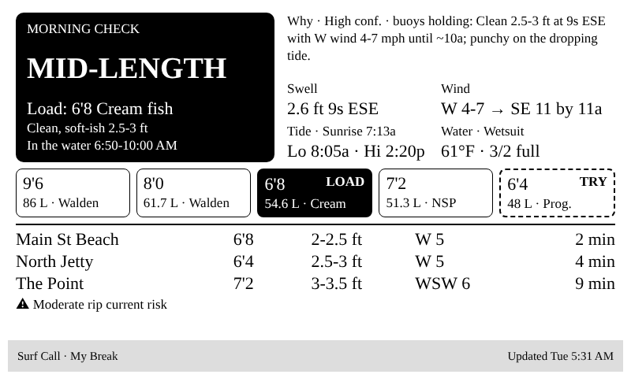

# TRMNL Surf Dashboards 🏄

Two e-ink surf screens for the [TRMNL](https://trmnl.com) display:

| **Surf Conditions** — live numbers, zero servers | **Surf Call** — "go or no go, and which board?" |
|---|---|
|  |  |
| TRMNL polls free Open-Meteo + NOAA APIs directly. Surf height estimate, rating, swell, wind (offshore/onshore *for your beach*), water temp, tides, 3-day outlook. | A scheduled AI agent (or any script) reads the forecasts, makes the call against *your* skill level and quiver, and pushes it to a webhook. Shows the board to load, why, when, where, and what to watch out for. |
| [Set it up →](plugins/conditions) | [Set it up →](plugins/surf-call) |

Built for a **TRMNL OG** (800×480, black and white) on the US East Coast, but both screens are easy to point anywhere.

## What's in here

```
plugins/
  conditions/            Polling plugin: Open-Meteo marine + wind, NOAA tides
    markup.liquid          paste into TRMNL → Edit Markup → Full
    polling-urls.txt       paste into Polling URL (fill in your coordinates)
    sample-data.json       example API responses for local previews
  surf-call/             Webhook plugin: the go/no-go + board call
    markup.liquid          paste into TRMNL → Edit Markup → Full
    PAYLOAD.md             every field, type and character limit
    examples/*.json        longboard, mid-length + progression, push day, no go
prompts/
  surf-check-prompt.md   the AI surf-forecaster prompt (fill in your quiver + breaks)
  trmnl-push-step.md     the step that turns its answer into a TRMNL payload
tools/
  preview.py             render any markup + JSON to an 800x480 PNG locally
  validate_payload.py    check a Surf Call payload before sending it
  push.sh                send a payload to your webhook
docs/screenshots/        renders of every example
```

## Quick start

**You need:** a TRMNL with the **Developer edition** add-on (needed for private plugins; unlock it under *Devices → Edit*).

1. **Conditions screen (10 min, no code):** follow [plugins/conditions](plugins/conditions/README.md). You'll fill in three values (two coordinate pairs and a NOAA station ID) and paste two files.
2. **Surf Call screen:** create the webhook plugin per [plugins/surf-call](plugins/surf-call/README.md), then test it with an example payload:
   ```bash
   export TRMNL_WEBHOOK_URL="https://trmnl.com/api/custom_plugins/<your-uuid>"
   ./tools/push.sh plugins/surf-call/examples/push-day.json
   ```
3. **Make it smart:** fill in [prompts/surf-check-prompt.md](prompts/surf-check-prompt.md) with your quiver, breaks and buoys, append [trmnl-push-step.md](prompts/trmnl-push-step.md), and schedule it in an AI agent that can browse the web and run code. Or write your own logic and push JSON in the same shape.

## Preview without a device

```bash
pip install -r requirements.txt && playwright install chromium
python3 tools/preview.py plugins/surf-call/markup.liquid plugins/surf-call/examples/*.json
python3 tools/validate_payload.py plugins/surf-call/examples/*.json
```

`preview.py` is a **stress test**, not an emulator. TRMNL's real framework CSS and fonts aren't published as a package, so it renders with deliberately oversized text, a fallback serif font, and conflicting CSS rules. It exits non-zero if anything overflows. If it fits there, it fits on the device with room to spare.

## Gotchas (learned the hard way)

1. **Don't name your CSS classes `row`, `col`, `flex`, `item`, etc.** TRMNL's framework already defines them, and your layout silently collapses on the device while looking fine elsewhere. Both markups here use **inline styles on plain `<div>`s** for layout and only TRMNL's own `label` / `value` classes for text.
2. **Don't set `font-family: inherit`.** It overrides TRMNL's device font and you get Times New Roman. Let the `label` / `value` classes pick the font.
3. **Overflow clips the top and bottom.** TRMNL's `.layout` centers content vertically, so a layout that's 30 px too tall loses 15 px of headings *and* 15 px of footer. Give sections fixed heights and test with `preview.py`.
4. **Webhook data ≠ an instant redraw.** A push is stored right away (GET your webhook URL to see it), but the image only re-renders when TRMNL decides to. According to the docs, that's immediately only if the plugin hasn't rendered in the last 15 minutes. Then the device shows it on its next wake. If the screen looks stale, open the plugin in TRMNL, **Save** (or force refresh), and press the button on the back of the device.
5. **Hosted AI agents need network access to `trmnl.com`.** Sandboxed agents (Claude scheduled tasks included) block unknown domains by default. Add `trmnl.com` to the allowed domains or every push fails.
6. **Your Webhook URL is a password.** Anyone with it can change your screen. Keep it in an environment variable or your agent's private prompt, never in git.
7. **Open-Meteo marine coordinates must be over water.** The wave model is a ~5 km ocean grid, and a point on the beach can return nulls. Nudge it 1–3 km offshore.
8. **Limits:** webhook payloads up to 2 KB (5 KB on TRMNL+), 12 pushes per hour (30 on TRMNL+). A full Surf Call payload is about 850 bytes.
9. **Have models build JSON with `json.dump`.** Board names like `9'6` and `8'0"` break hand-written JSON constantly.

## Safety

These screens summarize forecasts. They don't replace looking at the water. Surf heights here are estimates, AI calls can be wrong, and conditions change fast. Check the lifeguard flags and rip current statements, know your limits, and when in doubt, don't paddle out.

## Credits and license

- Wave and weather data: [Open-Meteo](https://open-meteo.com) (CC BY 4.0, free for non-commercial use)
- Tides: [NOAA CO-OPS](https://tidesandcurrents.noaa.gov)
- Not affiliated with TRMNL, Surfline, Open-Meteo, or NOAA.

MIT licensed. See [LICENSE](LICENSE). PRs welcome: new regions, tide sources for outside the US, layouts for the TRMNL X, and better surf-height heuristics.
