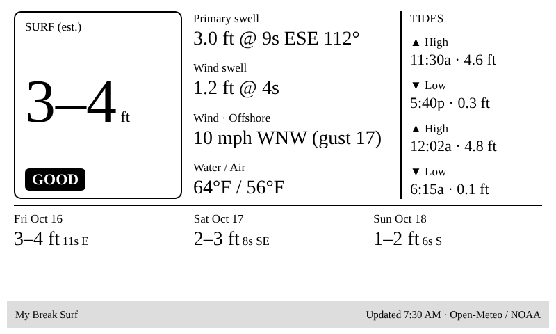

# Surf Conditions plugin

A Surfline-style "right now" screen built only from free, keyless data:

- **Surf height estimate** and a simple **FLAT / POOR / POOR-FAIR / FAIR / GOOD** rating
- **Primary swell** and **wind swell** (height, period, direction)
- **Wind** speed, gusts, direction, and whether it's **offshore / cross / onshore** for *your* beach
- **Water and air temperature**
- The **next 4 tides**
- A **3-day outlook** (size range, period, direction)



TRMNL polls the data itself, so you don't need a server, Home Assistant, or an AI agent.

## Data sources

| Block | Source | Notes |
|---|---|---|
| `IDX_0` | [Open-Meteo Marine API](https://open-meteo.com/en/docs/marine-weather-api) | Wave model on a ~5 km ocean grid |
| `IDX_1` | [Open-Meteo Forecast API](https://open-meteo.com/en/docs) | Wind and air temp at the beach |
| `IDX_2` | [NOAA CO-OPS](https://api.tidesandcurrents.noaa.gov/api/prod/) | Tide predictions; **US stations only** |

Open-Meteo is free for non-commercial use (attribution: CC BY 4.0). Outside the US, swap `IDX_2` for a local tide API and adjust the tide loop in the markup to match its response shape.

## Setup

1. **Pick your coordinates.**
   - `MARINE_LAT` / `MARINE_LON`: a point **1–3 km offshore** of your break. The wave model only has values over water, so a point on the sand can come back empty. Using a right-click in Google Maps to copy coordinates is the easiest way to get them.
   - `BEACH_LAT` / `BEACH_LON`: the beach itself (for wind).
2. **Find your tide station** at [tidesandcurrents.noaa.gov](https://tidesandcurrents.noaa.gov/tide_predictions.html) and copy its 7-digit ID into `NOAA_STATION_ID`.
3. **Change the timezone** in both Open-Meteo URLs if you're not on US Eastern (`America%2FLos_Angeles`, `Europe%2FLondon`, …).
4. In TRMNL: **Plugins → Private Plugin → New**, Strategy **Polling**, paste the three lines of `polling-urls.txt` (with your values) into **Polling URL**, and save. The order matters: the markup expects marine data first, wind second, tides third.
5. **Edit Markup → Full**, paste `markup.liquid`, and set the two config values at the top:
   - `spot_name`: shown in the title bar.
   - `offshore_deg`: the compass direction offshore wind blows **from** at your beach. For an east-facing beach that's about 270 (west). For a south-facing beach it's about 0 (north).
6. Add it to a playlist. Refreshing every 30–60 minutes is plenty, because the wave models update only every few hours.

## How the numbers are made (and their limits)

- **Surf height** is an estimate: offshore significant wave height times a factor that grows with swell period (0.5–0.8× under 7 s, 0.7–1.0× at 7–10 s, 0.9–1.3× at 10 s+). It tracks the right trend, but it doesn't model bathymetry, swell shadowing, or jetties the way Surfline's spot-calibrated numbers do. Tweak the factors for your break.
- **Rating** is a small heuristic: points for size (2 ft+, 4 ft+), period (8 s+), and offshore, cross-offshore or glassy wind, minus a point for strong onshore. It's a glance, not a forecast.
- The **wind label** compares wind direction to `offshore_deg`: within 45° is offshore, 45–80° cross-offshore, 80–100° cross-shore, 100–135° cross-onshore, beyond that onshore. Under 5 mph is "Light / glassy".

## Preview locally

```bash
python3 tools/preview.py plugins/conditions/markup.liquid plugins/conditions/sample-data.json
```
