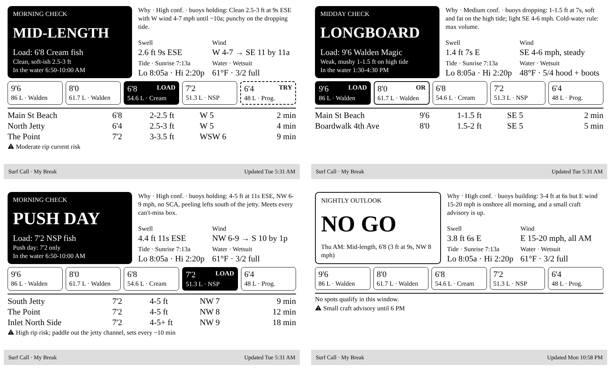

# Surf Call plugin

A **"go / no go — which board?"** screen. Something smart decides the call (in my setup, a scheduled AI agent that reads Surfline, surf-forecast.com, NDBC buoys and the NWS marine forecast), and pushes a small JSON summary to this plugin's webhook.



*Top: mid-length day with the 6'4 progression board marked TRY, and a cold-water longboard day with a borderline OR board. Bottom: a can't-miss push day, and a no-go with the next good window.*

What's on it:

- **The verdict:** LONGBOARD / MID-LENGTH / PUSH DAY / NO GO, with the board to load, why, and the in-water window
- **The reasoning:** a "Why" line with real numbers, a confidence level, and the buoy trend
- **Conditions:** swell, wind (and when it turns), tide, sunrise, water temp and wetsuit
- **Quiver rack:** every board you own, with the call highlighted:
  - **LOAD** (solid) is the board to bring
  - **OR** is the second choice on a borderline call
  - **TRY** (dashed) means today qualifies for your progression board
  - **BACKUP** is what to bring in case the progression board is a struggle
- **Spots:** up to 3 qualifying breaks, closest first, each with its best board, size, wind and drive time
- **Hazard:** the one safety note that matters most

## Setup

1. TRMNL: **Plugins → Private Plugin → New**. Name it `Surf Call`, set Strategy to **Webhook**, and **Save**. The Webhook URL only appears after the first save.
2. **Edit Markup → Full**, paste `markup.liquid`, and edit the config block at the top:
   - `spot_name`: the title bar text
   - The quiver lists (`q_ids`, `q_size`, `q_name`, `q_vol`, `q_full`): up to 5 boards, highest volume first
   - `prog_id`: which board is your "progression" board
3. Copy the **Webhook URL**. Treat it like a password, because anyone with it can change your screen.
4. Send a test payload:
   ```bash
   export TRMNL_WEBHOOK_URL="https://trmnl.com/api/custom_plugins/<your-uuid>"
   ./tools/push.sh plugins/surf-call/examples/midlength-progression.json
   ```
5. Hook up whatever makes the call. See [`prompts/`](../../prompts) for the scheduled-AI-agent version. Any script, cron job, or Home Assistant automation that can POST JSON works too.

Field-by-field reference: [PAYLOAD.md](PAYLOAD.md).

## Pushing from Home Assistant instead

A `rest_command` works fine if you compute the call in HA:

```yaml
# configuration.yaml
rest_command:
  surf_call_push:
    url: !secret trmnl_surf_call_webhook
    method: POST
    content_type: "application/json"
    payload: "{{ payload | tojson }}"
```

Then call `rest_command.surf_call_push` from an automation, with `payload: {"merge_variables": {...}}`.
